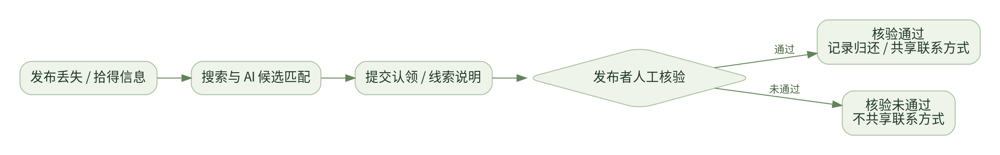
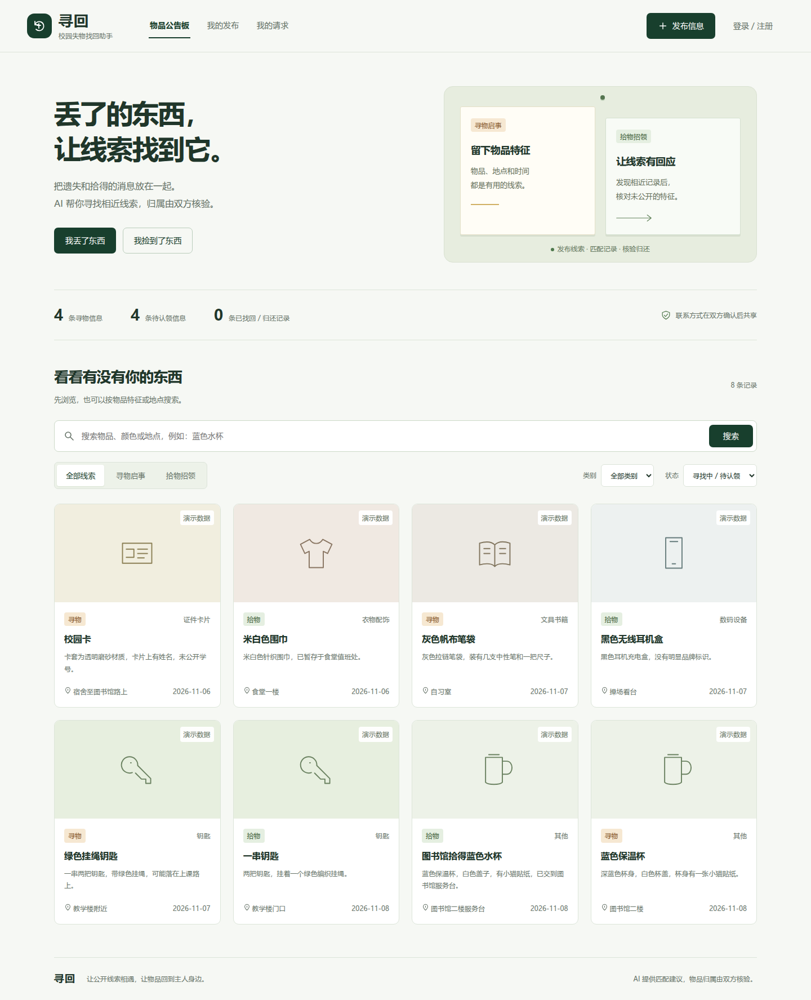
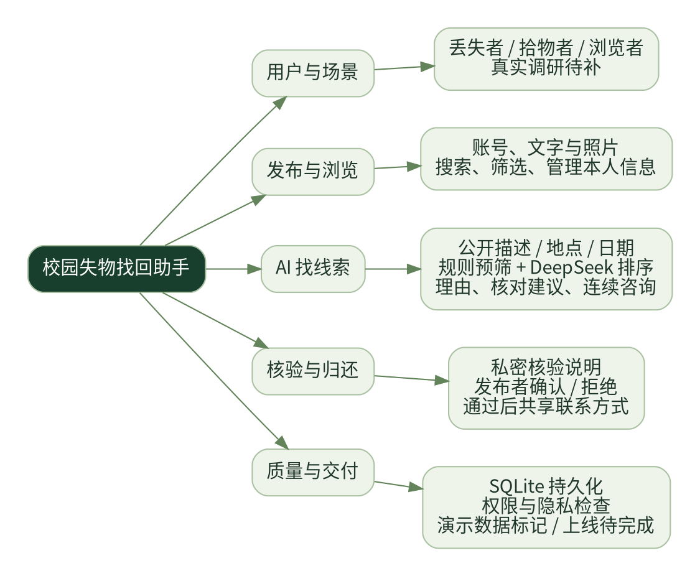
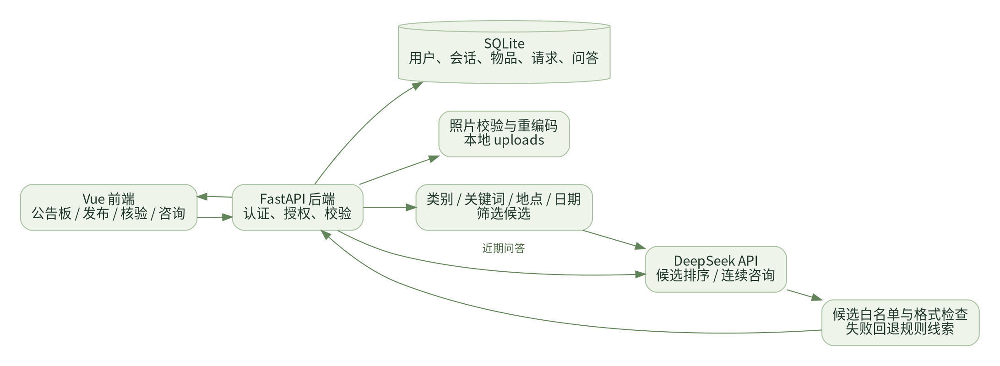
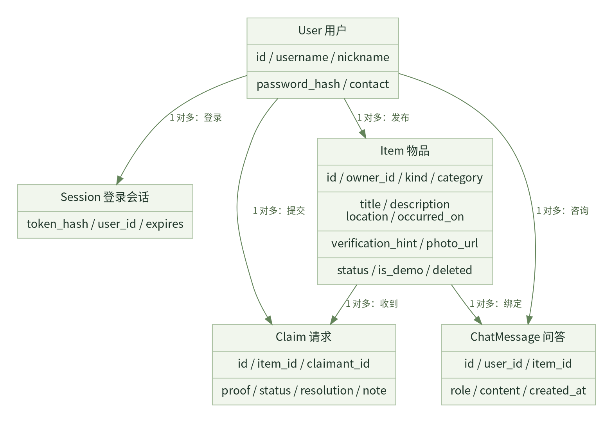

# 脉语团队：寻回——校园失物找回助手的选题报告与需求分析

| 项目 | 内容 |
|---|---|
| 作业所属课程 | [广东工业大学 2024 级计算机科学与技术 5、6 班课程主页](https://edu.cnblogs.com/campus/gdgy/Class56-Grade2024-CS/) |
| 作业要求 | [团队选题与需求分析作业](https://edu.cnblogs.com/campus/gdgy/Class56-Grade2024-CS/homework/16766) |
| 作业目标 | 从真实用户需求出发，将智能体嵌入可运行的软件，完成团队展示、选题报告、需求分析，并最终上线供师生检查 |
| 团队名称 | 脉语团队 |
| 团队成员 | 3124004197－蔡志冲；3124004213－林华杰 |
| 项目名称 | 寻回 · 校园失物找回助手 |
| 软件形式 | Web 网站 |
| AI 平台 | DeepSeek API |
| 项目仓库 | 待补充公开仓库链接 |
| 在线体验 | 公网部署待完成；本地演示地址为 http://127.0.0.1:8080/ |
| 文档版本 | V0.3；团队展示、选题报告和需求分析均包含在本文 |

目前已完成本地软件实现、自动化测试和真实 API 演示。真实用户调研、团队合照和公网部署尚待补充，本文不将演示数据或程序测试当作调研证据、真实找回案例。

## 一、团队展示

### 1. 团队介绍

我们是由蔡志冲和林华杰组成的两人团队。本次项目围绕校园失物找回展开，希望把分散的丢失、拾得消息集中起来，通过 AI 匹配公开线索，再由双方核验完成归还。

团队保留“脉语团队”的名称，产品名称为“寻回”。我们将共同参与需求讨论、代码评审、测试与答辩准备，具体职责安排如下。

| 学号 | 姓名 | 希望承担的软工角色 | 项目分工 | 个人风采 |
|---|---|---|---|---|
| 3124004197 | 蔡志冲 | 后端、AI 接入、部署 | FastAPI 接口、SQLite 数据与权限、DeepSeek 匹配和咨询、运行部署 | 性格、擅长技术及兴趣爱好待本人补充 |
| 3124004213 | 林华杰 | 前端、需求、测试 | 公告板与发布交互、认领核验页面、需求整理、验收测试及博客维护 | 性格、擅长技术及兴趣爱好待本人补充 |

这里描述的是团队的职责安排，不追溯认定每一段现有代码的作者。

### 2. 团队首次合照

**待补充：团队首次合照，以及拍摄时间、地点和成员说明。**

### 3. 项目愿景

我们希望让校园里的每一条失物线索都有回应。通过集中发布、智能匹配和人工核验，帮助丢失者找到可能相关的物品，也让拾物者方便地联系物主。我们将坚持信息最小公开、核验先于联系和结果清楚可追踪，把同学之间的善意连接起来，让找回物品成为简单可信的一件小事。

## 二、选题报告

### 1. 为什么选择校园失物找回

校园里常见的遗失物品包括校园卡、钥匙、耳机、书籍和水杯。失主和拾物者可能在不同的群聊或公告栏发布消息，描述方式也不一致：一方强调物品名称，另一方可能只写颜色、地点或外观。

我们提出的需求假设是：用户需要一个可以集中发布、检索和匹配线索的地方，还需要一套核验流程，避免仅凭公开描述就认领物品。这个场景容易接触到实际用户，但上述假设仍需用真实访谈验证。

### 2. 谁会使用这个系统

| 用户 | 典型场景 | 需要解决的问题 |
|---|---|---|
| 丢失者 | 丢失物品后，发布特征并寻找相关拾物记录 | 减少重复翻找消息，找到值得核对的候选 |
| 拾物者 | 捡到物品后，留下公开信息等待物主 | 便于回应认领，并核对不公开的特征 |
| 校园成员 | 浏览消息，为同学提供相关线索 | 快速定位物品和地点，提交有效说明 |

首版采用普通账号，不声称具有学校官方身份认证能力。

### 3. 项目定位与核心亮点

“寻回”是一款将 AI 嵌入失物招领流程的 Web 软件。基本流程是：

**发布信息 → 搜索或 AI 匹配 → 提交认领／线索说明 → 发布者核验 → 确认归还。**



核心亮点是：**AI 从不同表达的记录中寻找候选，并给出匹配理由和建议核对的问题；最终归属仍由发布者核验。**

例如，演示数据中有“蓝色保温杯”和“图书馆拾得蓝色水杯”两条记录。系统结合蓝色杯身、白色杯盖、小猫贴纸、地点和日期进行比较，把相关记录呈现给用户，再引导用户核对未公开的细节。这里是合成演示，不是发生在真实同学身上的找回案例。

项目还支持围绕一条物品信息持续咨询。用户可以问“下一步去哪里找线索？”或“认领时应该核对什么？”，AI 结合当前公开信息和近期问答继续回答。

### 4. 为什么采用 AI

普通公告板擅长发布和浏览，但用户仍需手动判断许多描述。AI 适合辅助比较文字特征、解释相近之处并组织核对建议。我们让程序负责认证、权限、状态和数据约束，让 DeepSeek 负责候选比较及咨询。

AI 的输出不会直接改变物品归属、批准请求或共享联系方式。模型返回的候选 ID 必须来自后端提供的记录，得分被限制在有效范围内。API 不可用时，系统明确回退为关键词线索，不把规则结果包装成 AI 成果。

## 三、真实需求调研

### 1. 当前证据状态

**目前尚未提供真实访谈或问卷记录。以下为待执行的调研安排，不能作为已完成调研的结论。**

拟面向有过丢失、拾物或帮同学转发经历的人进行访谈，重点了解他们最近一次具体经历，而不是只问“是否喜欢这个产品”。

### 2. 访谈问题

1. 最近一次丢失或捡到物品是什么时候？你通过哪些渠道处理？
2. 搜索或转发信息时，哪一步最耗时、最容易漏掉？
3. 你会怎样描述物品，哪些信息愿意公开，哪些希望保留？
4. 如果有人认领，你会核对什么才能放心归还？
5. 看到 AI 匹配的候选时，你需要什么理由才能决定联系对方？

### 3. 调研记录与需求追踪

| 日期／方法 | 受访者匿名编号及背景 | 具体经历／原话 | 证据位置 | 对应需求 |
|---|---|---|---|---|
| 待补充 | 待补充 | 待补充真实记录 | 待补充访谈笔记或问卷链接 | 待确认 |

调研完成后，应补写实际人数、主要发现、未被支持的假设，以及因此保留、删除或调整的功能。访谈引用和图片应取得相关人员同意。

## 四、需求分析

本节直接作为项目的需求规格说明，参考软件需求规范的组织思路，包含总体描述、前后端需求、数据模型、验收标准与范围限制。本文没有进行国家标准符合性认证。

### 1. 项目标志与界面

项目标志沿用软件中的绿色回转符号，表示物品回到主人身边；产品名称为“寻回”。


页面采用校园公告板风格，区分寻物与拾物，突出发布、搜索和核验操作。没有物品照片时展示类别图标，不将图标假称为实物照片。



截图中带“演示数据”的记录为虚构演示线索，统计数量来自截图时的数据库，不代表真实用户规模或真实找回效果。

### 2. 需求思维导图



需求分为五部分：用户与场景、发布与浏览、AI 线索匹配、核验归还、质量与交付。

### 3. 首版范围

首版包括账号登录、发布与照片上传、公开浏览搜索、本人信息管理、AI 候选匹配、认领／线索请求、发布者核验、联系方式授权共享和按物品持续咨询。

首版不包含学校 SSO、短信或邮件推送、图片智能识别、地图定位、自动交付或 AI 自动判定归属。照片用于人工比对。这些未实现能力不列入首版验收承诺。

### 4. 功能需求与验收标准

| 编号 | 功能描述 | 验收标准 | 当前情况 |
|---|---|---|---|
| F01 | 注册、登录、退出，建立用户会话 | 未登录不能发布或申请；密码散列保存；退出后会话失效 | 已实现并测试 |
| F02 | 发布寻物／拾物记录，填写描述、地点、日期及照片 | 必填信息有效，日期不能晚于当天；照片通过格式和大小校验 | 已实现，浏览器发布与照片上传通过 |
| F03 | 按关键词、类别、类型和状态浏览，支持分页 | 查询结果符合筛选条件，数量来自数据库，每页最多 24 条，支持日期范围与隐藏演示记录 | 已实现并测试 |
| F04 | 编辑、关闭、删除本人记录 | 非发布者不能修改；已归还不可编辑；有待核验请求不能直接删除 | 已实现并测试 |
| F05 | AI 比较相近线索，提供候选、理由和核对建议 | 只从后端候选中选择，不能返回不存在的记录；得分为有效相关度 | 真实 DeepSeek 演示通过 |
| F06 | AI 不可用时回退到规则线索 | 页面明确显示“关键词候选线索”及原因，不假称 AI 成功 | 已实现并测试 |
| F07 | 对他人记录提交认领／线索说明 | 本人不能申请自己的记录；待处理请求不重复提交；可撤回或补充说明再申请；说明只对双方可见 | 已实现并测试 |
| F08 | 发布者确认或拒绝请求 | 只有发布者可核验；通过后记录归还，其他待处理请求结束 | 双账号浏览器流程通过 |
| F09 | 核验通过后共享联系方式 | 公开列表、详情及未通过请求不包含联系方式；通过后只有双方可查看 | 已实现并测试 |
| F10 | 围绕物品持续咨询，保存近期问答并支持重置 | 用户与物品之间历史隔离；第二轮带首轮问答；失败不写入历史 | 真实两轮 DeepSeek 咨询通过 |
| F11 | 保存物品、请求、会话、聊天与图片 | SQLite 与图片存储可恢复；演示数据再次启动不重复创建 | 已实现并测试 |
| F12 | 提供可供师生检查的运行环境 | 一键启动可用；正式验收前提供外部可访问地址 | 本地运行已验证，公网部署待完成 |
| F13 | 修改本人资料与密码 | 联系方式不公开；密码修改使其他会话失效；演示账号资料固定 | 已实现并测试 |
| F14 | 编辑照片、备份和容器运行 | 文字与照片原子保存；备份不含密钥；容器重启后恢复数据 | 已实现并测试 |

### 5. 前端需求

| 页面／区域 | 展示内容与操作 | 反馈与异常处理 |
|---|---|---|
| 公告板 | 寻物与拾物记录、类别图标／照片、日期地点、真实状态数量 | 加载提示；无结果时提示调整搜索或发布信息 |
| 搜索筛选 | 关键词、类别、寻物／拾物类型、寻找中／已归还状态、分页 | 不混用不同筛选请求返回的结果 |
| 登录注册 | 账号、密码、昵称、私有联系方式 | 必填标签与长度约束；账号冲突或登录失败说明原因 |
| 发布编辑 | 名称、类别、描述、日期、地点、私密特征及照片 | 保存中防止重复提交；错误保留填写内容供修改 |
| 物品详情 | 公开描述、照片、发布者昵称和状态；本人管理操作 | 非发布者不展示私密核验特征，已归还操作受限 |
| 候选匹配 | 相关记录、得分、理由、核对建议 | 区分 AI 与规则模式；候选为空时给出说明 |
| 我的请求 | 收到的请求／本人请求、核验说明、处理状态 | 通过前不共享联系方式，核验动作需明确确认 |
| 咨询区 | 历史问答、输入框、等待状态 | Enter 发送、Shift+Enter 换行；错误保留问题；切换物品不混入旧回答 |

界面应在手机和桌面可操作，具备可见的键盘焦点与合理对比度。对话框支持 Escape 关闭及长内容滚动；系统偏好减少动态效果时减少非必要动效。

### 6. 后端需求与架构



- **Vue 前端：**提供公告板、表单、物品详情、核验与咨询交互。依赖保存在项目中，不需要额外启动前端构建服务。
- **FastAPI 后端：**负责接口、认证、资源授权、字段校验、图片处理、状态管理和 AI 调用。
- **SQLite：**保存账号、登录会话、物品、认领请求和问答。图片存储在本地 uploads 目录。
- **DeepSeek：**根据公开记录比较候选，或根据当前物品与历史问答进行咨询。

客户端不能指定物品发布者或伪造核验身份。审批由服务端检查当前登录用户与物品发布者的关系，再通过数据库事务更新请求和归还状态。

### 7. 领域类图与数据模型



图中描述领域数据与关系，不表示代码已经定义同名 Python 类；实际实现采用数据库表和服务函数。

| 实体 | 主要数据 | 关系与可见范围 |
|---|---|---|
| User 用户 | 账号、昵称、密码散列、联系方式 | 一个用户可发布多条记录；联系方式不在公开列表展示 |
| Session 登录会话 | 令牌散列、用户编号、过期时间 | 一个用户可有多个登录会话，退出会使当前会话失效 |
| Item 物品 | 类型、名称、类别、描述、地点、日期、照片、状态、私密特征、演示标记 | 绑定一个发布者；私密特征仅发布者可查看 |
| Claim 请求 | 物品编号、申请者编号、核验说明、状态、处理原因、处理备注 | 一条物品可收到多个请求；同一用户不能重复提交 |
| ChatMessage 问答 | 用户编号、物品编号、角色、内容、时间 | 按用户和物品隔离，近期历史可在刷新后恢复 |

物品状态为 `active`（寻找中／待认领）或 `returned`（已找回／已归还）；删除记录不再进入公开列表和匹配。请求状态为 `pending`、`accepted` 或 `rejected`，另以 `resolution` 保存撤回、拒绝、归还等处理原因，不能通过普通备注伪造。

### 8. 主要接口约定

| 接口 | 作用 | 权限与约束 |
|---|---|---|
| POST `/api/auth/register`、`/api/auth/login` | 注册和登录 | 输入校验，密码散列，会话 Cookie |
| GET `/api/auth/me`、POST `/api/auth/logout` | 当前用户和退出 | 用户仅能读取本人私有资料 |
| GET `/api/items`、`/api/items/{id}` | 公开列表与详情 | 不返回联系方式；私密特征仅本人详情可见 |
| POST `/api/items` | 发布，使用 multipart 字段和可选照片 | 需要登录 |
| PATCH／DELETE `/api/items/{id}` | 修改或删除 | 只能操作本人记录；待核验请求限制删除 |
| POST `/api/items/{id}/close` | 登记找回／归还 | 只能由发布者操作 |
| POST `/api/items/{id}/matches` | 匹配候选 | 只能为本人仍有效的记录寻找线索 |
| POST `/api/items/{id}/claims` | 提交认领／线索说明 | 登录、非发布者、记录有效、不能重复 |
| GET `/api/me/claims` | 读取双方相关请求 | 不返回无关用户的请求 |
| POST `/api/claims/{id}/decision` | 通过或拒绝 | 只有发布者可操作，已经处理的请求不可再次审批 |
| GET／POST `/api/items/{id}/chat` | 历史问答与咨询 | 需要登录，按用户＋物品隔离 |

未登录、越权、输入错误、重复操作、过期审批版本和 AI 失败应返回相应错误信息，不能统一显示为成功。

### 9. AI 匹配与持续咨询要求

匹配先检索最新最多 150 条仍有效、类型相反且属于其他用户的记录，再按类别、公开描述、地点和日期预筛最多 12 条交给 AI，最终返回最多 8 条候选。真实记录与演示记录分开匹配和认领，避免把虚构演示物品推荐给真实用户，也防止真实核验说明提交给共享演示账号。

AI 返回的候选编号需经过白名单验证，得分限制在 0～100，相关度不能解释为物主概率。模型格式错误、认证失败、余额不足、限流或超时，应说明原因并展示规则线索。

咨询使用当前物品的公开信息和最近 20 轮问答。私密核验特征和账号联系方式不进入 AI 输入；首版不进行照片智能识别。失败的问题不写入已成功的历史问答，同一用户对同一物品的请求串行处理。

### 10. 数据、安全与质量约束

- 注册账号长度为 3～24，密码长度为 8～128；密码使用加盐 PBKDF2 散列，不保存明文密码。
- 发布标题为 2～80 字符、描述为 5～2000 字符、地点为 2～100 字符；私密核验特征最多 500 字符。字段内容不能只为空格。
- 咨询问题最多 2000 字符；AI 同时最多处理两个请求，繁忙时说明原因。
- 照片单文件最多 5 MiB，支持 JPG、PNG、WebP。服务端验证解码、限制总像素并将最长边缩到不超过 1600px，处理方向并重编码，移除原始 EXIF 元信息。
- 物品描述和照片由用户自行决定公开内容，页面提示不要公开联系方式或全部核验特征，也应遮挡照片中的学号等信息。
- 登录会话通过 HttpOnly Cookie 传递；写操作检查跨站来源。正式部署使用 HTTPS 和安全 Cookie。
- SQLite、会话、请求、近期聊天及图片需要持久保存。演示账号新发的信息也应明确标记演示数据。
- 推荐单个 Uvicorn worker，保持同一咨询请求的顺序与 AI 并发限制。公网性能需在部署设备上测试，本文没有承诺未经测量的响应速度。

## 五、项目规划与当前成果

### 1. 实施安排

| 阶段 | 主要工作 | 交付内容 | 当前状态 |
|---|---|---|---|
| 场景与需求整理 | 确定用户、流程和首版边界 | 本文选题与需求章节 | 已整理，真实调研证据待补 |
| 基础软件实现 | 账号、发布、搜索、图片及本人管理 | 可运行 Web 原型 | 已完成本地实现 |
| AI 与核验闭环 | 匹配、咨询、请求、核验、归还与授权联系 | 完整业务流程 | 已完成并演示验证 |
| 回归验证 | 输入、权限、隐私、AI 降级与状态流转 | 自动化测试和浏览器检查 | 已执行，见下节 |
| 上线与实地验收 | 部署、外部访问、实际用户试用 | 公网网址和用户验收记录 | 待完成 |

没有将学校身份认证、硬件联动或图片识别写入已完成成果。

### 2. 已执行的验证

**当前 22 项后端自动化测试、6 项前端状态回归通过。**覆盖登录退出、公开与私密字段、认领及审批、通过后联系授权、重复请求、照片校验、候选白名单、规则降级、咨询隔离、跨站检查、本人管理及演示／真实匹配隔离。

真实浏览器检查已完成以下流程：

1. 在 1440、1024、768、390、320px 浏览页面，未发现横向溢出。
2. 使用两个独立浏览器上下文登录两个演示账号。
3. 真实调用 DeepSeek，匹配公开记录并显示相关候选。
4. 真实调用 DeepSeek，完成连续两轮咨询。
5. 丢失者向拾物记录提交认领说明，拾物者人工确认归还。
6. 查看只有在通过后才共享的演示联系方式。
7. 通过页面上传 PNG，并查看重编码后的照片和演示标记。

这些检查证明演示链路可以运行，不代表已有真实校园找回案例、准确率统计或完整用户验收。

### V0.3 补充验证

新增页面流程已在独立测试数据库验证，不改动用户使用中的数据：认领可撤回、拒绝后可以补充说明，发布者审批时检查请求版本；编辑照片无效时保持原记录；资料修改后联系方式更新，密码修改使其他会话失效；持续咨询可重置。旧数据库升级会保留已有记录。

Docker 镜像已实际运行，验证重启后数据与照片恢复，并生成不包含密钥的一致备份。公网访问仍未完成，不能将容器本机运行称为已上线。

### 3. 一键体验

在项目所在机器运行：

```bash
"/home/cc/workspace/homework/software engineering/3124004197/campus-lost-found/start.sh" --demo
```

脚本会打开正确项目的本地页面。演示账号为 `demo_lost` 和 `demo_found`，密码均为 `demo123456`。所有演示信息均为虚构线索，正式上线应使用独立数据目录和真实注册账号。

已提供 Docker 部署配置，但没有执行公网发布。本地地址只能用于本机体验，正式作业检查仍需补充外部可访问的网址。

## 六、迭代记录

| 版本 | 日期 | 变更内容 | 验证与状态 |
|---|---|---|---|
| V0.1 | 2026-11-08 | 实现校园失物找回、账号发布、AI 匹配、核验联系、持续咨询和运行脚本 | 后端测试及真实浏览器流程通过，公网待部署 |
| V0.2 | 2026-11-08 | 将团队博客、选题和需求规格合并为本文，补充思维导图、领域类图、前后端约定与验收标准 | 文档整合；调研、合照等真实资料待团队补充 |
| V0.3 | 2026-11-09 | 完善资料／密码修改、认领撤回与补充、审批版本校验、照片编辑、日期筛选、对话重置与备份 | 22 项后端、6 项前端回归及真实浏览器、容器验证通过；公网部署待完成 |

后续修改需求时，应同步更新受影响的功能编号、验收标准和版本记录。尚未实现的扩展能力，须经过需求确认后再加入验收范围。

## 发布前需要补充的真实材料

- [ ] 团队首次合照及成员的性格、兴趣、擅长技术。
- [ ] 真实访谈／问卷、原始证据与由调研得到的结论。
- [ ] 公开项目仓库链接和完成部署后的体验网址。
- [ ] 将本文引用的本地图片上传至博客园，再替换为平台图片地址。

本文已经包含完整的首版需求分析，不需要再提交一份独立需求文件。
